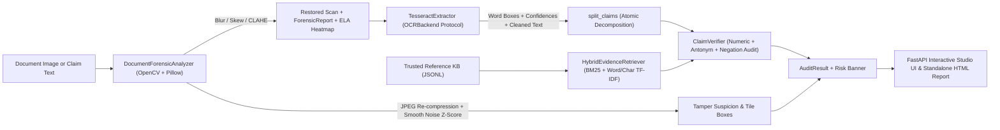

# VeriDoc Forensics

[](https://github.com/Thush099/veridoc-forensics/actions/workflows/tests.yml)

**Multimodal Document OCR, Forensic Image Quality Auditor & Citation-Grounded Claim Verification Studio**

VeriDoc Forensics is an end-to-end offline Python & FastAPI system that audits scanned compliance and financial documents across two orthogonal layers: **pixel-level image integrity** (blur sharpness, geometric skew rectification, dynamic range, Error Level Analysis, and local smooth-background noise anomalies) and **citation-grounded factual verification** (hybrid Okapi BM25 + word/char TF-IDF evidence retrieval with structured numeric, entity, and polarity entailment checking).

---

## Architecture Overview



---

## Measured Benchmark Results

Captured by running `PYTHONPATH=src .venv/bin/python main.py --benchmark --json` across the three offline synthetic compliance document scenarios. OCR metrics are an observed run with the local Tesseract installation and may vary by environment.

| Scenario | Raw Char Acc | Restored Char Acc | Raw Word Acc | Restored Word Acc | Tamper Detection | Claim Verdicts | Faithfulness | Latency |
| :--- | :---: | :---: | :---: | :---: | :---: | :---: | :---: | :---: |
| `clean` | 100.0% | 100.0% | 100.0% | 100.0% | `CLEAN (0.00)` | 5 / 5 | 100.0% | 519 ms |
| `skewed_blurry` | 0.0% | 100.0% | 0.0% | 100.0% | `CLEAN (0.00)` | 5 / 5 | 100.0% | 1,201 ms |
| `tampered_hallucinated` | 100.0% | 100.0% | 100.0% | 100.0% | **`FLAG (1.00)`** | 5 / 5 | 20.0% | 526 ms |

**Aggregate Benchmark Summary** (`2,445.1 ms` total runtime):
- **Mean Raw vs. Restored Character Accuracy**: `66.7% -> 100.0%`
- **Mean Raw vs. Restored Word Accuracy**: `66.7% -> 100.0%`
- **Claim Verdict Classification Accuracy**: `100.0%` (`15 / 15` expected or produced claims)
- **Tamper Detection Accuracy**: `100.0%` (zero false positives on uniform degraded scans)

---

## Core Modules

| Module | Responsibilities |
| :--- | :--- |
| [`src/veridoc/forensics.py`](src/veridoc/forensics.py) | `DocumentForensicAnalyzer`: Laplacian blur variance, horizontal projection-profile skew estimation & automatic affine deskewing, percentile/CLAHE contrast recovery, bilateral + unsharp denoising, in-memory JPEG Q90 Error Level Analysis (ELA), smooth-background noise/luminance MAD Z-score tamper flagging, ELA heatmap PNG, and side-by-side comparison SVG helpers. |
| [`src/veridoc/ocr.py`](src/veridoc/ocr.py) | `TesseractExtractor` and `OCRBackend` protocol: wraps `pytesseract.image_to_data` to return line-ordered text, per-word bounding boxes, word confidences, mean OCR confidence, and low-confidence token flags while safely handling blank pages. |
| [`src/veridoc/synthetic.py`](src/veridoc/synthetic.py) | `generate_demo_suite`: deterministic offline generator producing 200-DPI compliance memos (`clean`, `skewed_blurry`, and `tampered_hallucinated` with a spliced JPEG-recompressed patch) paired with a trusted JSONL reference corpus. |
| [`src/veridoc/verifier.py`](src/veridoc/verifier.py) | `HybridEvidenceRetriever` + `ClaimVerifier` + `split_claims`: sentence-safe claim splitting (preserving decimals & abbreviations), hybrid Okapi BM25 + word/char-ngram TF-IDF cosine retrieval, and typed numeric/polarity/negation entailment auditing (`SUPPORTED`, `PARTIAL`, `CONTRADICTED`, `UNVERIFIED`). |
| [`src/veridoc/pipeline.py`](src/veridoc/pipeline.py) | `VeriDocPipeline` & `render_audit_html`: orchestrates forensics, OCR, verification, overall risk classification (`LOW`, `MODERATE`, `HIGH`, `CRITICAL`), and standalone dark/light printable HTML audit reports. |
| [`src/veridoc/server.py`](src/veridoc/server.py) | FastAPI application serving the zero-build dark-mode **Interactive Document Forensics & Claim Verification Studio UI** and REST endpoints with binary-safe stdlib multipart upload support. |
| [`src/veridoc/benchmark.py`](src/veridoc/benchmark.py) | End-to-end evaluator computing Levenshtein character/word accuracy before and after restoration, tamper accuracy, claim classification accuracy, and per-scenario latency. |

---

## Quickstart

### 1. Prerequisites
- Python `>= 3.10`
- System Tesseract OCR binary (`tesseract-ocr` / Homebrew `tesseract`)

### 2. CLI Usage

```bash
# Run the full forensic + OCR + verification benchmark
PYTHONPATH=src python main.py --benchmark

# Gate a CI job on the benchmark's claim-verdict accuracy (exits non-zero below the bar)
PYTHONPATH=src python main.py --benchmark --min-claim-accuracy 0.95

# Run built-in scenarios and export a standalone HTML forensic audit report
PYTHONPATH=src python main.py --demo tampered_hallucinated --export-html audit-report.html

# Export the same report with the light theme (default is dark)
PYTHONPATH=src python main.py --demo tampered_hallucinated --export-html audit-report.html --theme light

# Verify a local document image against a custom JSONL knowledge base
PYTHONPATH=src python main.py --verify-image scan.png --corpus reference_kb.jsonl --json

# Launch the interactive FastAPI Studio UI (http://127.0.0.1:8000)
PYTHONPATH=src python main.py --serve --port 8000
```

### 3. Docker Quickstart

```bash
docker build -t veridoc-forensics:latest .
docker run --rm -p 8000:8000 veridoc-forensics:latest
```

### 4. Running Tests

```bash
PYTHONPATH=src pytest -v
```

---

## API Reference

| Method & Path | Description | Request Payload |
| :--- | :--- | :--- |
| `GET /` | Serves the zero-build dark-mode **Interactive Document Forensics & Claim Verification Studio UI**. | — |
| `GET /health` | Returns service health and local Tesseract binary availability/version. | — |
| `POST /api/analyze-demo` | Runs the full pipeline on `"clean"`, `"skewed_blurry"`, or `"tampered_hallucinated"`. | `{"scenario": "tampered_hallucinated"}` |
| `POST /api/verify` | Audits an uploaded PNG/JPG (`file`) or raw `claim_text` against an optional `corpus_jsonl`. Requests are limited to 10 MiB and images to 20 megapixels; malformed base64 image data returns HTTP 400. | `multipart/form-data`, `application/x-www-form-urlencoded`, or JSON (`image_base64` / `claim_text`) |
| `POST /api/export-html` | Converts an `AuditResult` payload into a standalone printable dark or light HTML report (`?theme=dark\|light`). | `AuditResult` JSON |

---

## License

MIT License © 2026 Thushanth Mahendran. See [LICENSE](LICENSE).
